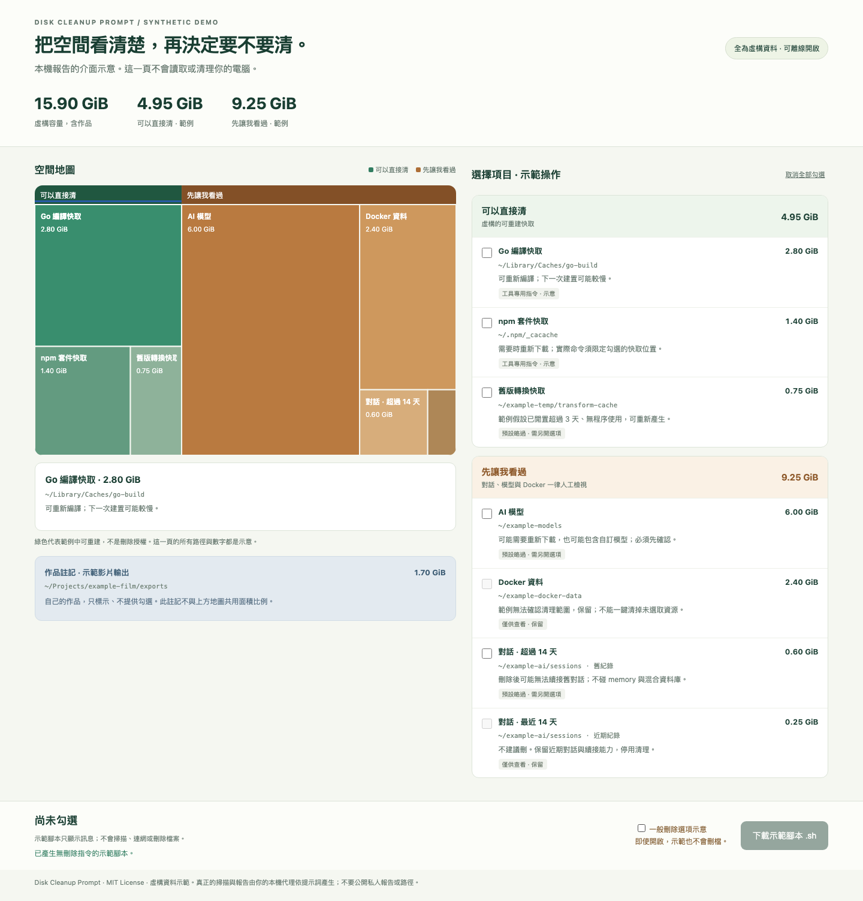

# Disk Cleanup Prompt

Inspect disk usage first. Decide what to remove yourself.

This repository shares a Traditional Chinese prompt for a local AI agent to inspect **file-system metadata**, produce a local treemap report, and offer a downloadable cleanup script. The agent must not run cleanup commands.

[Traditional Chinese README](README.md) · [Copy the prompt](prompts/disk-cleanup.zh-TW.md) · [Usage guide](docs/usage.zh-TW.md)

## Use it

1. Open an AI agent that already has local command execution and file-writing capabilities. Do not grant additional administrator or full-disk permissions for this task.
2. Copy the [complete prompt](prompts/disk-cleanup.zh-TW.md). The agent must adapt its approach to the actual operating system and verify its output.
3. Open the generated `index.html`, review each path and consequence, then select items and download the cleanup script if wanted. Run it yourself in a terminal; it must require the exact input `yes` before proceeding.

The prompt requests a size-proportional treemap, two review groups, protected personal projects, a 14-day conversation-history split, conservative worktree checks, age and activity checks for temporary files, and append-only size history in `sizes.csv`.

Cleanup should use each tool's own command only when its scope matches the selected item. Other deletion methods are disabled by default. Worktrees must use `git worktree remove`, never recursive deletion or `--force`.

## What this repository is—and its limits

The repository contains prompts, documentation, and a **synthetic offline demo**. It does not ship a production scanner or a portable cleanup engine. A macOS implementation of the workflow has been exercised; Windows and Linux scanning and cleanup are not tested here. Your agent must report unsupported or unverified behavior honestly.

To view the demo, download the repository ZIP, extract it, and open `examples/demo.html` in a browser. It never scans your disk. Its downloadable demonstration script only prints a message and exits.

Real reports can reveal usernames, project names, paths and activity. Do not publish generated reports, size logs, cleanup scripts or real screenshots. Metadata may also be processed by your AI provider; metadata-only scanning is not a privacy guarantee.

## License

[MIT](LICENSE). Use, adapt and share the prompts, documentation and demo with attribution through the license notice.
